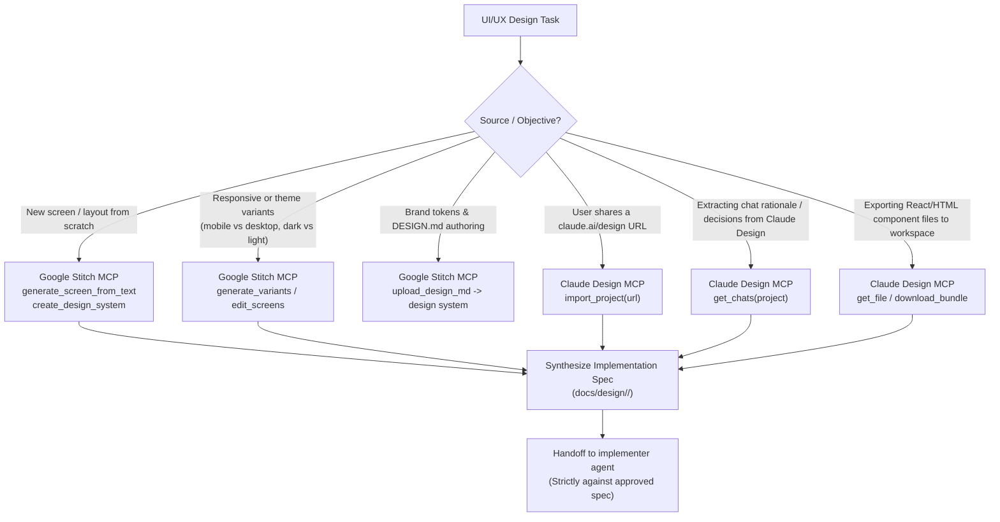

# Claude Design MCP Workflow

> Unofficial stdio MCP bridge for Anthropic's Claude Design (`https://api.anthropic.com/v1/design/mcp`).
> Integrated for homelab UI/UX engineering: bridges live `claude.ai/design` canvases into local codebases.

---

## 1. Core Tool Reference

| Tool | Purpose | Key Arguments | Typical Output / Usage |
| :--- | :--- | :--- | :--- |
| `import_project` | Fetches code files + metadata from a Claude Design project URL | `url`: full `claude.ai/design/p/?file=...` URL | Imports the complete project code bundle into local memory. Primary entry point. |
| `get_chats` | Returns design conversation history and reasoning | `project`: project ID or name | Extracts design constraints, user preferences, and iteration rationales. |
| `list_projects` | Lists all Claude Design projects on the account | *(none)* | Returns project names, IDs, creation timestamps, and file counts. |
| `get_project` | Gets detailed metadata for a specific project | `project`: project ID | Inspects active design systems, frameworks, and root files. |
| `list_files` | Lists all files inside a design project | `project`: project ID | Lists paths, file sizes, and MIME types. |
| `get_file` | Reads contents of a specific file in the project | `project`, `path`, `offset?`, `limit?` | Reads individual TSX/JSX/CSS/HTML files. |
| `download_bundle`| Downloads full ZIP archive (code + images + assets) | `project`, `dest?` | Saves complete bundle to local workspace (`docs/design/<project>/`). |

---

## 2. Synergistic Decision Matrix: Stitch MCP vs. Claude Design MCP

The `ui-designer` is the **sole consumer** of both Google Stitch MCP (`mcp__stitch__*`) and Claude Design MCP (`mcp__claude-design__*`). Use the following decision tree:

### Detailed Boundary Comparison

| Scenario | Primary Tool | Secondary / Bridge Action | Rationale |
| :--- | :--- | :--- | :--- |
| **New Green-Field UI Design** | **Google Stitch MCP** | None | Stitch generates whole-screen visual mockups from pure functional descriptions with zero pre-existing code. |
| **Iterating on Layout or Component Arrangement** | **Google Stitch MCP** | None | `edit_screens` and `generate_variants` provide fast macro-visual exploration without code compilation. |
| **Importing Prototype from `claude.ai/design`** | **Claude Design MCP** | None | `import_project` directly pulls the real React components, JSX structure, and CSS assets authored in Claude Design. |
| **Extracting Design Intent & Nuances** | **Claude Design MCP** | Stitch for visual parity | `get_chats` retrieves the exact back-and-forth prompt iterations that created the design. |
| **Tailwind v4 Token Mapping** | **Synergistic / Both** | Stitch defines token contract (`@theme`), Claude Design validates component utility classes. | Tokens live in `DESIGN.md`; Stitch ensures global consistency; Claude Design code validates concrete markup. |

---

## 3. Quota & Safety Protocol

1. **Authentication & Session:**
   - Claude Design credentials are authenticated via `/design-login` in Claude Code CLI or `npx claude-design-mcp login`.
   - Credentials persist in `~/.config/claude-design-mcp/credentials.json`.
2. **Frugal File Retrieval:**
   - Always call `list_files` before reading files.
   - Fetch only relevant TSX/CSS files; avoid downloading large unneeded media files directly into agent context.
3. **Artifact Directory Structure:**
   - Store all imported or generated assets in:
     `docs/design/<project>/claude-design/` (for Claude Design bundles)
     `docs/design/<project>/screens/` (for Stitch screen HTML/PNG)
     `docs/design/<project>/DESIGN.md` (authoritative token contract)
4. **Handoff Contract:**
   - `ui-designer` designs, imports, and specifies; `implementer` writes production code.
   - Never paste raw generated code directly into production files without human or implementer review.
